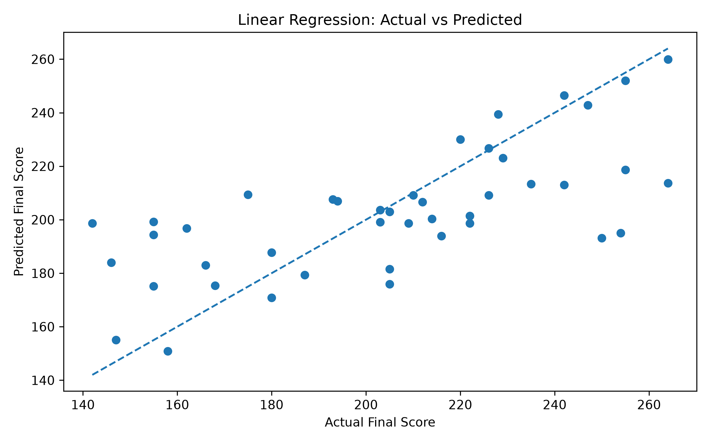

# Cricket Score Predictor

Predicts an IPL team's final first-innings score from the match situation after 5, 10 or 15 overs, using Linear Regression (pandas, matplotlib, scikit-learn).

  


## Team and roles

| Member | Entry no. | GitHub handle | Role |
|---|---|---|---|
| Jujhar Singh | 2026MCB1532 | @jujharsingh5479| Setup and execution |
| Srinath Dixit | 2026EEB1413 | @2026eeb1413-dotcom | PPT lead|
| Souvik Das | 2026AIB1084 | @Souvikiit00 | Documentation lead |
| Randhi Pujitha | 2026DAB1304 | @Pujitha2008 | Video lead |

All four members contributed code (see the commit history).

## Problem and dataset

**Problem.** While a team is batting first, can we estimate where its innings will end? Given the score, wickets lost and overs completed at a checkpoint (5, 10 or 15 overs), the model predicts the final first-innings total. This is a regression problem.

**Data.** IPL 2026 ball-by-ball data (source: <add link to where you downloaded it>).

- `data/ipl_2026_ball_by_ball.csv`: the raw data, 17,509 deliveries, 25 columns, 74 matches.
- `data/ipl_score_prediction.csv`: the dataset we built from it, 213 rows from 71 matches (one row per match per checkpoint).

| Column | Meaning |
|---|---|
| `Match_ID`, `Innings` | match identifier; always first innings (1) |
| `Overs` | checkpoint: 5, 10 or 15 overs completed |
| `Current_Runs`, `Wickets` | score and wickets lost at that checkpoint |
| `Final_Runs` | the innings' final total (**the value we predict**) |

**Preparation (`src/data_prep.ipynb`).** Keep only first innings, count legal deliveries (wides and no-balls do not count), take the score after exactly 30, 60 and 90 legal balls, and attach the innings' final score. Three shortened or abandoned innings and any snapshot where the team was already all out were removed.

## Project structure

```
Cricket-score-predictor/
├── data/
│   ├── ipl_2026_ball_by_ball.csv     # raw data
│   └── ipl_score_prediction.csv      # prepared dataset (created by data_prep.ipynb)
├── src/
│   ├── data_prep.ipynb               # raw data -> prepared dataset
│   └── main.ipynb                    # explore, split, train, evaluate, plots
├── outputs/                          # plots are saved here
├── Presentation/ 
    ├── slides.pdf                            # slides (PDF)
├── requirements.txt
└── README.md
```

## Setup

Tested on Python <3.xx> (<Windows / macOS / Ubuntu>).

```bash
git clone https://github.com/<username>/Cricket-score-predictor.git
cd Cricket-score-predictor
python -m venv .venv
source .venv/bin/activate        # Windows: .venv\Scripts\activate
pip install -r requirements.txt
```

`requirements.txt` pins the library versions we used (pandas, numpy, matplotlib, scikit-learn, jupyter).

## How to run

1. Start Jupyter from the repository folder: `jupyter notebook`
2. Open `src/data_prep.ipynb` and choose **Run All**. It reads `data/ipl_2026_ball_by_ball.csv` and writes `data/ipl_score_prediction.csv` (the prepared file is already included, so this step is optional).
3. Open `src/main.ipynb` and choose **Run All**. It trains the model, prints the metrics and saves the plots in `outputs/`.

All paths are relative, so nothing needs editing. Expected run time: under a minute.

## Expected output

Test set: 15 matches the model never saw during training (matches are split as whole matches, so no match appears in both training and test data).

| | MAE (runs) | RMSE (runs) | R² |
|---|---|---|---|
| Linear Regression  | 19.27 | 25.37 | 0.4764 |

Average test error by checkpoint: about 21 runs at 5 overs, 17 at 10 overs and 13 at 15 overs.



<!-- Add a screenshot of the notebook's metrics output, e.g. outputs/results_screenshot.png -->

**Interpretation.** The model is clearly better than the run-rate baseline and its error shrinks as more of the innings is played. With only 71 matches, the score depends noticeably on which matches land in the test set (average error ranged from about 15 to 26 runs across five different splits), so the results should be read as indicative.

## Links

- Slides (5): [`Presentation/slides.pdf`](Presentation/slides.pdf)
- Video (≤ 5 min): <unlisted YouTube or Drive link>

## AI-use disclosure

- Claude (Anthropic): reviewed our `data_prep` code and suggested fixes (use first innings only, snapshot at the first row of the checkpoint, drop shortened innings); drafted the first version of the exploration, train/test, evaluation and plotting cells in `main.ipynb`, and of this README, plus help with Git commands. We ran and checked the code and edited it; all members can explain it.
- No AI was used to generate the dataset or the results.